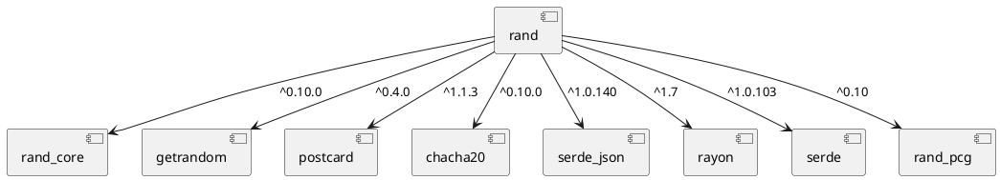
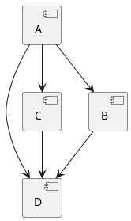
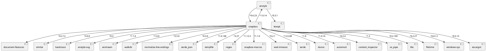

# Dependency-Graph
Практическая работа 2, вариант 29 ИКБО-23-25

## Общее описание

Программа для визуализации графа зависимостей на языке диаграмм PlantUML для менеджера пакетов с форматом Rust (Cargo).

## Описание функций и настроек

Для запуска программы необходимо передать следующие параметры:
* имя пакета.
* URL-адрес в формате https:// или путь к тестовому скрипту.
* тестовый режим для работы с текстовым файлом (если не требуется - "").
* версия пакета.
* глубина анализа зависимостей (целое число, не может быть меньше 1).
* фильтр для исключения пакетов из анализа (название исключаемого пакета).

## Описание команд для сборки проекта и запуска тестов

Структура текстового файла:
```text
A: B, C, D, E
B: D, E
C: D
D: E
E:
```
Команда запуска тестового режима:
```bash
python ../src/main.py A script1.txt 1 "" 1 ""
```
## Примеры использования
1. Визуализация графа зависимостей пакета rand

Запуск программы:
```bash
python ../src/main.py rand https://crates.io "" 0.10.3 1 ""
```
Результат работы программы:

Визуализация в формате PNG:


<br>

2. Визуализация графа зависимостей из текстового файла с исключением пакета

Содержимое текстового файла:
```text
A: B, C, D, E
B: D, E
C: D
D: E
E:
```
Запуск программы:
```bash
python ../src/main.py A script2.txt 1 0 3 E
```
Результат работы программы:

Визуализация в формате PNG:
<br>

<br>
3. Визуализация графа зависимостей пакета anstyle

Запуск программы:
```bash
python ../src/main.py anstyle https://crates.io/ "" 1.0.14 2 ""
```
Результат работы программы:

Визуализация в формате PNG:

